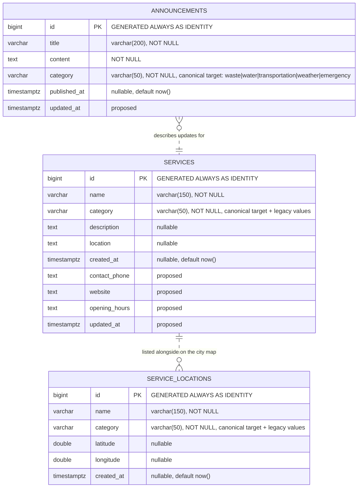

# Entity Relationship Diagram

Solid entities and attributes are the **observed** Supabase schema (verified
read-only on 2026-10-20, PostgreSQL 17.11). Attributes marked *(proposed)*
appear in `docs/migrations/001_add_contact_and_audit_fields.sql` and are **not**
applied.

## Notes on the model

- There are **no foreign keys** in the current database. The relationships above
  are logical: a service and its map location share a name and category but are
  stored independently. A future normalisation could add
  `service_locations.service_id`, but that is not proposed here because the two
  tables can legitimately diverge (for example, a service without coordinates).
- `latitude` / `longitude` are nullable; the map endpoint only returns rows
  where both are present and within valid ranges.
- `category` is free text at the database level. Validation lives in the API
  (`server/lib/categories.js`) and the UI (`client/src/categories.js`).
- `id` is a `bigint` identity column and never exposed as a sequential business
  key.

## Canonical categories

| Id | Label | Notes |
| -- | ----- | ----- |
| `waste` | Waste | Waste management services (FR-06). |
| `water` | Water | Water supply services (FR-07). |
| `transportation` | Transportation | Transport information (FR-08); legacy `transport` also matches. |
| `weather` | Weather | External weather integration (FR-24). |
| `emergency` | Emergency | Emergency services and contacts (FR-09). |
| `other` | Other | UI-only group for rows that still use a legacy value. Never stored automatically. |
